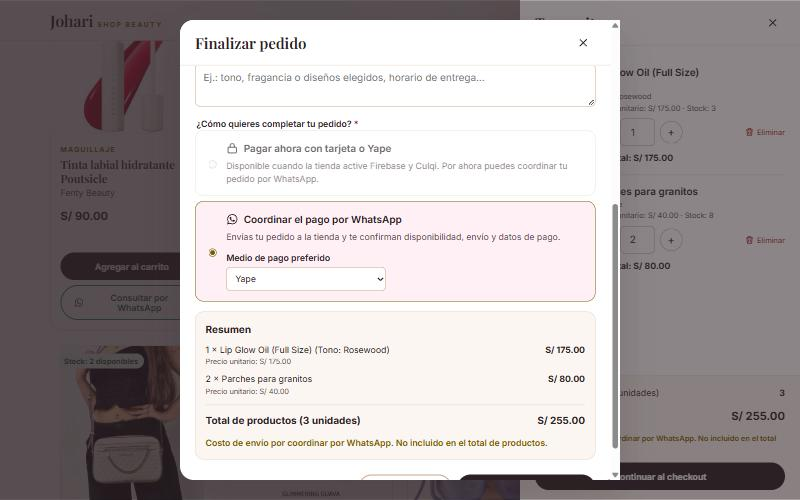
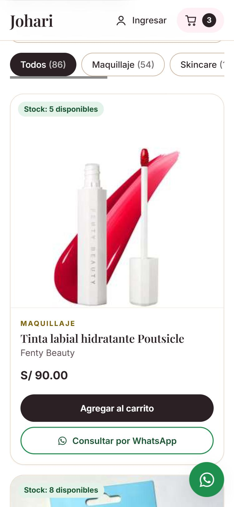

# Johari Shop Beauty · Tienda online

E-commerce para **Johari Shop Beauty**, un emprendimiento peruano de maquillaje, skincare, perfumes, bolsos y accesorios. Las clientas exploran el catálogo, arman su carrito y **pagan en línea con Culqi (tarjeta o Yape)** o coordinan su pedido por WhatsApp. La dueña administra productos, stock e imágenes desde un panel propio.

**Demo:** <https://johari-shop-beauty.netlify.app>


| Catálogo con búsqueda y filtros | Checkout | Vista móvil |
|---|---|---|
|  |  |  |

## Funcionalidades

**Para clientas**
- Catálogo de 86 productos con fotos, estados de stock (disponible, **AGOTADO**, por confirmar) y precios anteriores.
- Búsqueda en tiempo real sin distinguir tildes, mayúsculas ni signos («victorias» encuentra «Victoria's Secret»), combinable con filtros por categoría.
- Variantes con inventario propio (tonos, modelos, packs): hay que elegir una antes de agregar.
- Carrito lateral persistente que nunca supera el stock y avisa si cambia un precio o se agota un producto, incluso con el checkout abierto.
- Dos formas de completar el pedido:
  - **Pago en línea con Culqi:** tarjeta o Yape, con el monto calculado en el servidor.
  - **WhatsApp:** mensaje con productos, totales y datos de entrega.
- Registro, inicio de sesión y recuperación de contraseña.

**Para la dueña**
- Panel de inventario: crear, editar y eliminar productos; precio, precio anterior, stock y variantes; imágenes por URL o subida (comprimidas en el navegador).
- Resumen de productos, unidades, agotados y stock por confirmar.
- Lista de **pedidos pagados** en línea con datos de entrega.

## Tecnologías

| Capa | Tecnología |
|---|---|
| Frontend | HTML5 semántico, **CSS propio** (variables de diseño, BEM, mobile-first) y **JavaScript con módulos ES**, sin frameworks ni build |
| Datos y cuentas | Firebase Authentication y Cloud Firestore (con reglas de seguridad) |
| Pagos | Culqi Checkout v4 y **Cloud Functions** (Node 20) |
| Pruebas | `node:test` para la lógica de pedidos del backend |
| Despliegue | Netlify o Firebase Hosting |

## Arquitectura

```
├── index.html               Estructura y diálogos accesibles
├── css/
│   ├── base.css             Tokens de diseño, reset y utilidades
│   ├── layout.css           Encabezado, portada, catálogo y pie
│   └── components.css       Botones, tarjetas, carrito, checkout y panel
├── js/
│   ├── main.js              Punto de entrada: elige servicios y conecta módulos
│   ├── config.js            Configuración (modo, Firebase, Culqi)
│   ├── state.js             Estado compartido y bus de eventos
│   ├── core/                DOM seguro, formato, validaciones y almacenamiento
│   ├── data/                Catálogo inicial y reglas de producto
│   ├── store/cart.js        Carrito y reconciliación con el inventario
│   ├── services/            Demo (localStorage), Firebase, Culqi y errores
│   ├── features/            Catálogo, carrito, checkout, cuenta y panel
│   └── ui/feedback.js       Notificaciones, modales y confirmaciones
├── functions/               Cloud Functions: createOrder y payOrder (+ pruebas)
├── firestore.rules          Reglas de seguridad
├── firebase.json            Configuración de despliegue
└── docs/CONFIGURACION.md    Guía para activar Firebase y Culqi
```

## Seguridad

- **Sin datos sensibles en la web:** la página no publica números de cuenta. Los pagos en línea los procesa Culqi y los datos para transferencia se piden por WhatsApp.
- **Monto calculado en el servidor:** `createOrder` lee precios y stock de Firestore, y `payOrder` vuelve a verificarlos antes de cobrar con la llave secreta, que vive solo en Secret Manager.
- **Stock consistente:** el descuento se hace en una transacción de Firestore después de un cobro aprobado.
- **Roles en el servidor:** el rol de administradora se asigna con `admins/{UID}` desde la consola. Las reglas impiden que un cliente se dé ese rol o modifique productos.
- **DOM seguro:** todo el texto dinámico se inserta como nodos de texto (sin `innerHTML`) y las URL de imagen se validan.

## Accesibilidad

Diálogos con foco atrapado, cierre con Escape y devolución del foco; formularios con etiquetas y errores asociados (`aria-describedby`); foco visible; textos alternativos y respeto por `prefers-reduced-motion`.

## Ejecutar localmente

Los módulos ES necesitan un servidor http (no funcionan con `file://`):

```bash
python -m http.server 8080
```

Después abre `http://localhost:8080`. Sin configuración, la tienda arranca en **modo demostración** (datos en el navegador). Cuenta de prueba de la dueña: `duena@johari.demo` / `JohariDemo2026`. En el panel, «Herramientas de catálogo → Aplicar stock de ejemplo» habilita productos para probar el carrito.

Pruebas del backend:

```bash
cd functions
```

```bash
npm test
```

## Producción

Para conectar Firebase y Culqi, sigue [docs/CONFIGURACION.md](docs/CONFIGURACION.md). Necesitas un proyecto de Firebase con plan Blaze (para Cloud Functions) y una cuenta de Culqi.

## Autor

Desarrollado por **Mauro Contreras** · [GitHub](https://github.com/mauroalberto080405-create)
